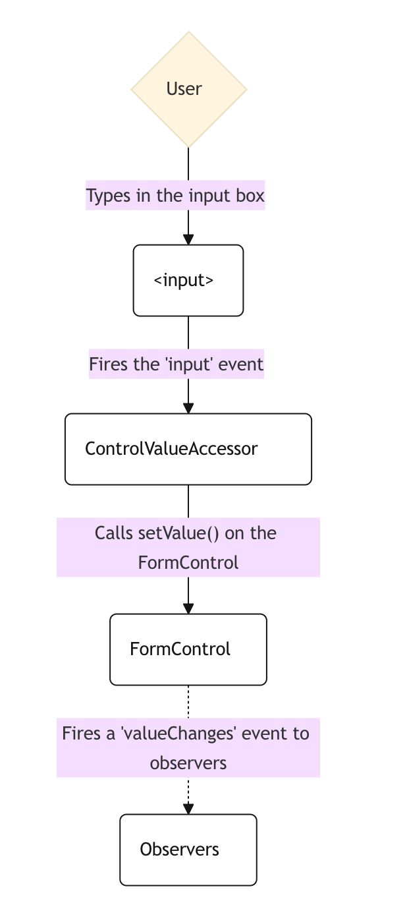
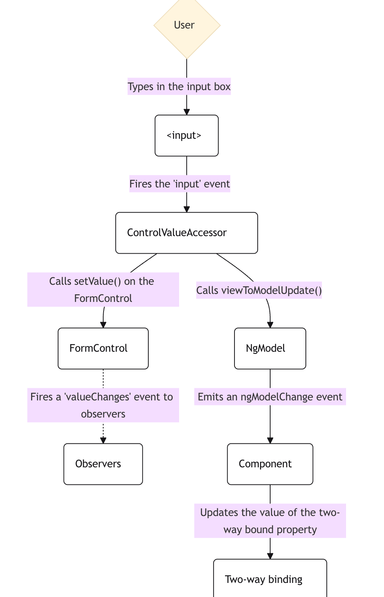

在 Angular 開發表單時有兩種選擇，一種是**Template-Driven Forms(模板驅動型表單)** ，另一種為**Reactive Forms(響應式表單)**。  
平常開發 Web 時，如果只是資料量較少、邏輯單純的表單，使用 Template-Driven Forms 會比較直覺，像是透過 ngModel 進行雙向綁定，就可以很快完成欄位與變數之間的資料同步。  
但如果遇到欄位較多、驗證邏輯複雜，甚至會動態新增、刪除或切換狀態的企業型表單，Reactive Forms 通常會更方便管理。

詳細說明一下兩者的定義與差異。

## Template-Driven Forms(模板驅動型表單)

Template-Driven Forms 以 HTML 模板為核心，表單邏輯、資料綁定與部分驗證規則主要都寫在 HTML 標籤中，再由 Angular 根據模板建立對應的表單模型。

### 主要特色：

- 主要透過 ngModel 進行資料雙向綁定
- 表單模型主要由 Angular 根據 Template 自動建立
- 資料更新會經過 NgModel 與 Angular 的變更偵測流程
- 適合邏輯單純、欄位固定的表單，例如登入、註冊或聯絡表單

### 示例：

假設現在有一個只有帳號與密碼的登入表單：

```Typescript
import { Component } from '@angular/core';
import { FormsModule } from '@angular/forms';

@Component({
    selector: 'app-login',
    standalone: true,
    imports: [FormsModule],
    templateUrl: './login.component.html',
})

export class LoginComponent {
    account = '';
    password = '';

    submit() {
        console.log({
            account: this.account,
            password: this.password,
        });
    }
}
```

HTML 中直接透過 [(ngModel)] 綁定 Component 裡的變數：

```html
<form (ngSubmit)="submit()">
  <label>
    帳號
    <input type="text" name="account" [(ngModel)]="account" />
  </label>
  <label>
    密碼
    <input type="password" name="password" [(ngModel)]="password" />
  </label>

  <button type="submit">登入</button>
</form>
```

## Reactive Forms(響應式表單)

以 Typescript 為核心，開發者先在 TS 中建置好明確的表單結構，再將這個表單模型與 HTML 模板綁定，因為結構與邏輯皆封裝在 TS 中，因此可以針對特定的表單元素直接進行操作。

### 主要特色：

- 在 TS 中建立表單物件，例如 FormControl、FormGroup、FormArray
- 表單結構與操作邏輯主要集中在 Component
- 可以直接取得及操作指定的 FormControl
- 適合欄位較多、驗證複雜或需要動態調整的大型表單

### 示例：

同樣使用帳號與密碼的登入表單：

```TS
import { Component } from '@angular/core'; 
import { FormControl, FormGroup, ReactiveFormsModule, } from '@angular/forms'; 

@Component({ 
    selector: 'app-login', 
    standalone: true, 
    imports: [ReactiveFormsModule], 
    templateUrl: './login.component.html', 
}) 

export class LoginComponent { 
    form = new FormGroup({ 
        account: new FormControl(''), 
        password: new FormControl(''), 
    }); 
    
    submit() { 
        console.log(this.form.value); 
    } 
}

```

```html
<form [formGroup]="form" (ngSubmit)="submit()" > 
    <label> 帳號 <input type="text" formControlName="account" /> </label> 
    <label> 密碼 <input type="password" formControlName="password" /> </label> 
    <button type="submit">登入</button> 
</form>
```

關於前述的「運作機制」，以下從資料流的角度來說明兩者表單建構上的差異：  
一個頁面可以分作 view 和 model，view 就是使用者看到的畫面 UI，而 model 則是被儲存的資料結構。

## Reactive Forms：同步 (Synchronous) 的資料流

在 reactive form 中，畫面上每個表單元素都可以與一個 FormControl 實例相連結，因此不管是從頁面上的 input 元件輸入值，或是從邏輯上操作 FormControl，他的資料都是同步的。  
以官方文件提供的範例說明：

- 當使用者在畫面的輸入框輸入一個值
- 這個 HTML 表單元素會觸發原生的 `input` 事件，並帶上最新輸入的值。
- 負責橋接的 `ControlValueAccessor` 監聽到這個事件後，會立刻將新值同步給背後的 `FormControl` 實例。
- 接著，`FormControl` 會透過 `valueChanges` 這個 Observable 將新值推播出去。
- 任何有訂閱 `valueChanges` 的程式碼，就能在第一時間取得最新的資料。

<div style={{ maxWidth: "400px" }}>



</div>

## Template-Driven Forms：非同步 (Asynchronous) 的資料流

在 Template-Driven Forms 中，表單元素是透過 NgModel 這個指令來管理的。它依賴雙向綁定與 Angular 的「變更偵測機制 (Change Detection)」，因此在將資料從 model 送到 view 時，會牽涉到非同步的任務排程。

- 當使用者在畫面的輸入框輸入一個值
- 這個 HTML 表單元素會觸發原生的 `input` 事件，並帶上最新輸入的值。
- 負責橋接的 `ControlValueAccessor` 監聽到事件後，會去觸發內部 `FormControl` 實例的 `setValue()` 來更新值。
- 接著，`FormControl` 會透過 `valueChanges` 這個 Observable 把新值推播出去。
- **不同的地方來了**：`ControlValueAccessor` 接著還會去呼叫 `NgModel` 的方法，並發出一個 `ngModelChange` 事件。
- 因為我們在畫面上寫了雙向綁定（也就是 `[(ngModel)]`），元件 (Component) 裡的變數要等到接收了這個事件，才會真正被更新成最新的值。
  
<div style={{ maxWidth: "400px" }}>



</div>

# 結論

一開始學習 Reactive Forms 開發表單時，光是在 TS 中建立表單結構及資料驗證等步驟就讓我卡了好久，不過使用一段期間並了解他的資料流之後，資料同步的特色對於複雜動態表單的管理可說是一大福音。  
下一篇就來介紹如何在 TS 中使用 Reactive Forms 建立表單結構吧！
